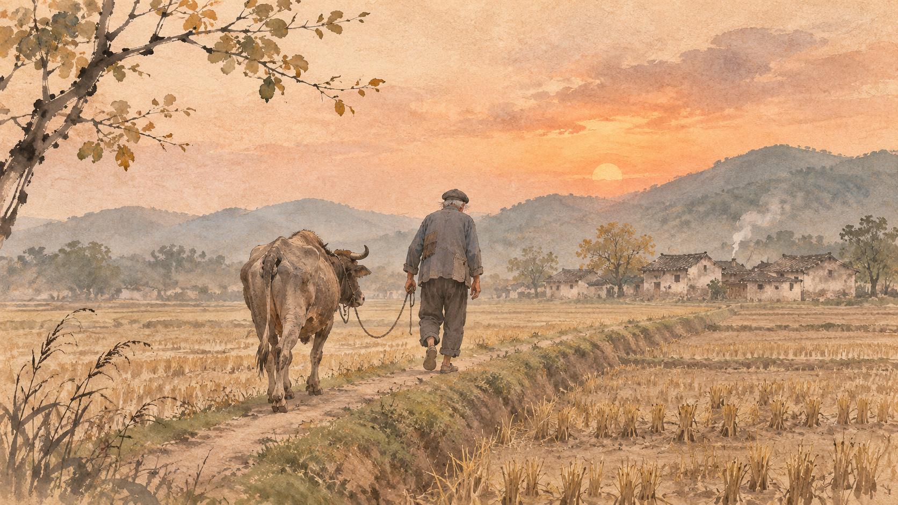

<figure class="article-figure">

<figcaption>Fugui and his old ox, walking through the fields at sunset.</figcaption>
</figure>

Long before I encountered Yu Hua’s writing, I came across these two lines: “Fugui, there are six people in your family.”
“Fugui, there are five graves in your family.”
Before I had read the book, I more or less imagined that Fugui’s life must be unbearably bitter, even though his name carries such an auspicious meaning.
Recently, I finally had the opportunity to read it, and these are my reflections:

*To Live* follows the life of its protagonist, Fugui.
Through the dramatic turns of his fate, the novel portrays the transformations of twentieth-century Chinese society and offers a parable of ordinary people struggling to survive beneath the crushing weight of their times.
Fugui’s life is tragic, at least for most of it.
Suffering and misfortune are magnified without limit in him, forcing me to confront a question clearly: when a person has endured so many calamities capable of stripping away his dignity, how does he continue living, and how can he find meaning in life amid all that suffering?

For a long time after finishing the book, I saw Fugui as an unfeeling sufferer, little more than a walking corpse.
One heartbreak follows another, crushing him until he no longer knows how to face the days ahead, and so he arrives at this conclusion: a person lives for nothing else; a person lives simply to live.
But on closer thought, when the elderly Fugui recounts the events of his life, his voice contains more than regret and unwillingness to accept what happened.
More than anything, it contains remembrance.
I thought about this for a long time: how can a person do that?
After losing his parents, his wife, both of his children, and his grandson, how can he still look back with longing?
Slowly, I came to understand.
Whether positive or negative, a person’s experiences remain their experiences.
The brief joys that came before disaster are also worthy of celebration, recollection, and remembrance.

Fugui goes from compulsive gambling and reckless self-indulgence, to family ruin and submitting to whatever comes, and finally to calmly embracing the emptiness of existence.
What he learns is never how to regard life and death, but how to understand the meaning of living through one loss after another.

Below are some scenes that remain vivid in my memory, recorded here so that I will not forget them in the years ahead:

After Long Er schemes to win Fugui’s family property from him at the gambling table, Fugui’s father does not let him repay the debt with lightweight silver dollars or banknotes.
Instead, he converts the entire family fortune into heavy copper coins and makes Fugui carry them over, load by load.
For the first time, the young Fugui feels the physical weight of money instead of seeing it as two weightless lines in a ledger.
He also comes to understand just how hard-won that slow accumulation was: from a chicken to a goose, from a goose to a sheep, and from a sheep to an ox.

Fugui’s name is Fugui.
Fugui, Fugui: good fortune is, of course, precious.
Fortune is hard to come by, and keeping it close is harder still.
The backlash that follows once fortune has scattered is something I would never be willing to bear.

Fengxia is left deaf and unable to speak after a high fever, then later dies from postpartum hemorrhaging; Youqing, small and thin, later dies after too much of his blood is drawn; Kugen, whose name means “Bitter Root,” is given that name because he loses his mother at birth, helps his father and grandfather with their work from childhood, and ultimately dies after eating too many beans.
Fate leaves behind too many riddles, and it always seems to have countless seemingly absurd ways of shattering your hopes.
The only thing we can do is accept what comes.

I offer this essay in remembrance of Fugui’s life, from a pampered young heir to a man tempered into one who could bear suffering.
Thank you to *To Live*, and thank you for reading.
