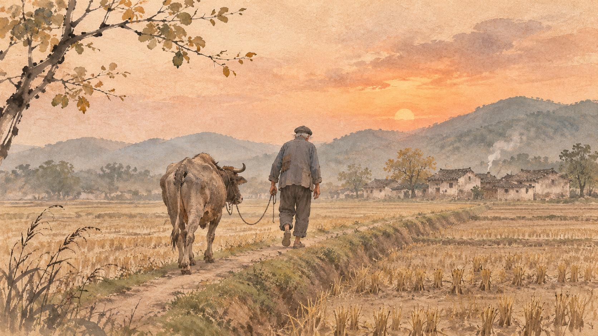

<figure class="article-figure">

<figcaption>夕阳下，福贵与老牛走过田野。</figcaption>
</figure>

很早之前，在接触余华的文字之前，我就看见了这样一句话：“福贵，你家六口人啊”“福贵，你家五口坟啊”。
在没有读到这本书之前，我心里大抵是这样想的：福贵的一生肯定苦不堪言，明明有个寓意这么好的名字。
最近，我终于得到机会去读了这本书，下面是我的读后感想：

《活着》以主人公福贵的一生为主线，通过他跌宕起伏的命运轨迹，展现了二十世纪中国社会的变迁，以及时代碾压之下普通人的生存寓言。
福贵的一生是悲惨的，至少他生命中的大部分时光是这样。
苦难与不幸在福贵身上被无限放大，让我清楚地认识到：当一个人经历了这么多足以抹去尊严的不幸，他该如何活下去，又该如何在这些苦难里找到活着的意义。

读完这本书后的很长一段时间，我都把福贵看作一个麻木不仁、行尸走肉般的受难者。
伤心事一件接着一件，压得他不知该如何面对往后的日子，于是他得出了那个结论：人活着不为别的，人活着就是为了活着。
可是仔细一想，当老福贵讲述自己一生的事迹时，他的语气里除了惋惜与不甘，更多的其实是一种怀念。
我思考了许久：人怎能做到如此？
失去了父母、爱人、一对儿女和外孙，竟还能怀念？
慢慢地我想明白了。
人的经历不管是正面的还是负面的，它终归都是经历。
灾难来临前那些短暂的欢愉，也值得歌颂，也值得去回忆、去怀念。

福贵从嗜赌成性、放浪形骸，到家道中落、逆来顺受，再到最后坦然接纳生命的虚无，他学到的从来不是如何看待生死，而是在一次次失去中理解活着的意义。

下面是一些让我记忆犹新的情节，以免我日后遗忘：

当福贵的家产被龙二用赌局设计骗走后，他父亲没有让福贵拿轻便的银元或纸钞去还债，而是把家当全换成了笨重的铜钱，让他一担一担挑着去还。
这让年轻的福贵第一次掂出了金钱的重量，而不再是账本上轻飘飘的两行字。
福贵也由此体会到，从鸡到鹅、从鹅到羊、再从羊到牛的那份积攒，究竟有多么来之不易。

福贵的名字是福贵。
福贵，福贵，福当然贵。
福来之不易，让福留在身边更是难上加难。
而福散之后的反噬，是我无论如何也不愿承担的。

凤霞在一场高烧后成了聋哑人，后来死于产后大出血；有庆身形瘦小，后来死于抽血过量；苦根因一出生就没了娘而得名苦根，从小帮着爹和外公干活，最后却因吃豆子撑死了。
命运留下了太多谜语，也总有无数种看似荒唐的方式来打碎你的希望。
我们能做的，唯有接纳。

谨以此文铭记福贵从纨绔子弟一路被锤炼成苦难承受者的一生。
感谢《活着》，感谢阅读。
