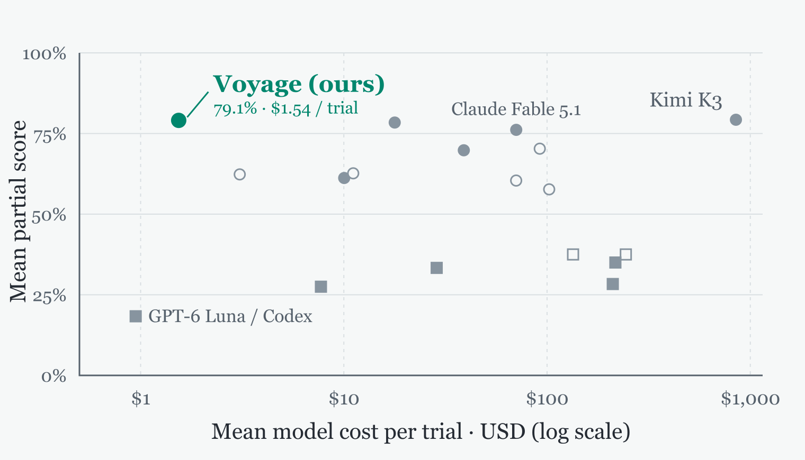

Introducing Voyage, a new long-running mode for Diffex, for ambitious coding tasks: porting a framework, designing a product, or building one from zero to one.
The bet is that frequent compaction with active recall matters more than a large context window alone.

## Give Voyage a destination

Voyage works best with an outcome the agent can verify.
Start with `/plan`, then give the plan to Voyage with `/goal` in the Diffex CLI.

## Benchmark setup and cost

On 15 CPU-only SWE-Marathon v1.1 tasks, eight trials each, Voyage with GPT-6 Luna reached a **22.5% full-pass rate**, 4.2 percentage points above the same model in Codex.
Its **79.1% mean partial score at \$1.54 per trial** nearly matched Kimi K3's 79.3% at about \$850.
*Partial credit measures progress, not a completed task.*

## Voyage context management

Built on [Pocket Context](/blog/pocket-context/), Voyage lets the agent choose what to compact and when.
Original evidence stays archived; a recall subagent searches it and returns a cited answer when details are needed.

## Try Voyage

[Read the full announcement on the Diffex blog](https://diffex.ai/blog/voyage) for installation, benchmark details, and the implementation.
